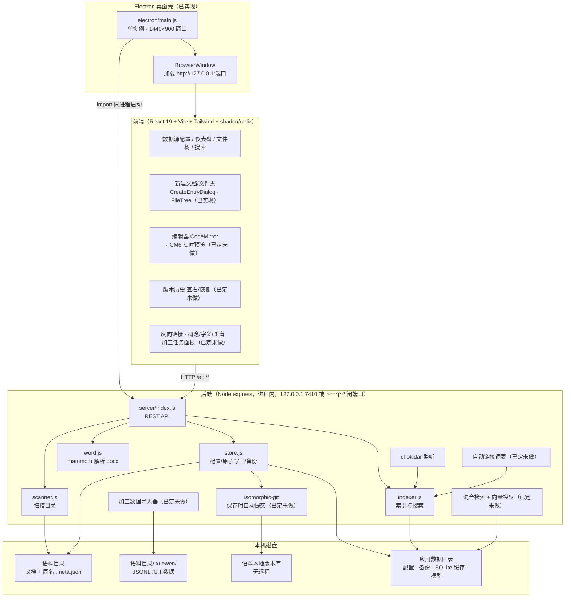
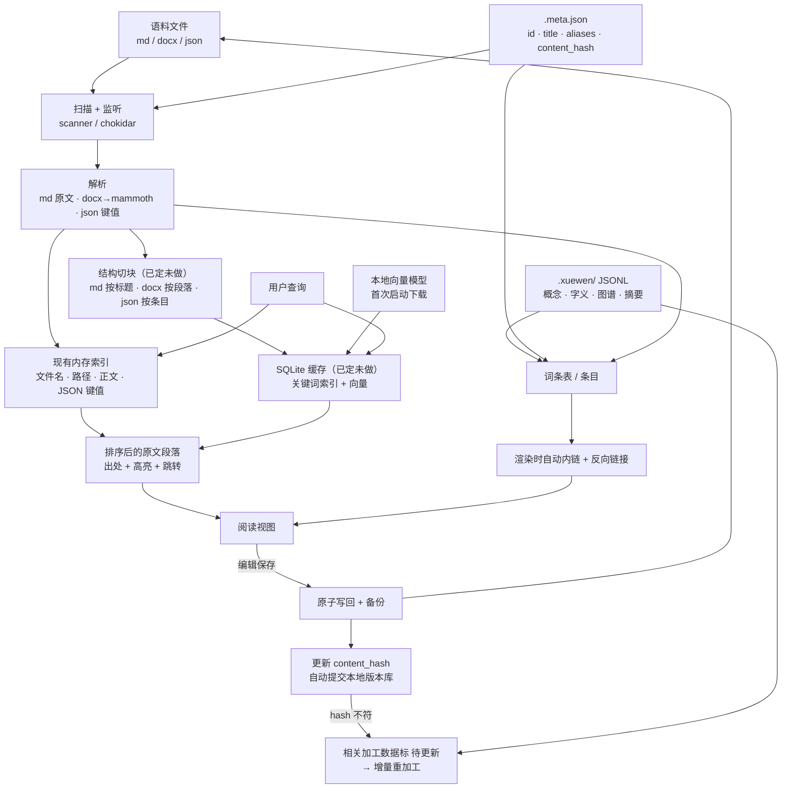

# 学问工作台 · 架构设计文档

版本：v0.2（2026-10-17 20:30 台北时间更新）｜读者：主人、后续开发者｜产品需求见 [PRD.md](./PRD.md)｜决策记录见 [decisions.md](./decisions.md)

**状态标记**（每节标题或条目后标注）：
- 【已实现】代码已在主人 Mac 上，验收通过
- 【进行中】正在开发
- 【已定未做】方案已定，尚未开发
- 【待定】未决定，注明取决于什么

> 本文只写结构与规则，不含任何语料正文。示例文件名（如 `论语讲稿.md`）仅为说明命名规则。

---

## 1. 概览与原则

**是什么**：给一位教传统文化的老师用的本地桌面工作台，集中阅读、检索、编辑老师的文章 / 讲稿 / 知乎问答（doc / md / json，约几百份），并逐步加入知识库检索、自动链接和二次加工数据（图谱、字义、总结 / 主题 / 概念）。范围与术语以 PRD（v0.3）为准。

**代码位置**：主人 Mac `/Users/mayu/Projects/学问workbench`，npm 包名 `corpus-workbench`。只用本地 git，**按设计不设远程**。

**设计原则**
1. **原文是唯一的“真”**：链接、检索结果、加工数据都不写回原文；保存时除用户改动外字节不变。
2. **全部本地**：语料和加工数据不出本机；唯一的网络请求是首次下载向量模型。
3. **派生数据可重建**：SQLite 索引是缓存，删掉可从原文 + `.meta.json` + `.xuewen/` 重建。
6. **版本可回溯**：代码和语料各有一套只在本机的 git 历史，永不推送远程。
4. **稳定 id 做锚点**：文档 id 生成后永不改，图谱 / 字义 / 概念都挂在 id 上，不挂在路径上。
5. **跨平台**：macOS（目标机 Apple M5 Max 128GB）与 Windows 都要能跑。

---

## 2. 总体架构

### 2.1 组件图



### 2.2 数据流图



---

## 3. 模块说明

### 3.1 桌面壳（Electron）【已实现】
- 选型理由：复用现有 Node 后端（见 decisions.md 2026-10-17 19:58）。
- `electron/main.js` 在主进程内直接 import express 服务，绑定 `127.0.0.1`，端口优先 7410，被占则取下一个空闲端口；轮询 `/api/config` 就绪后再开窗口。
- 单实例锁；窗口 1440×900。
- 环境变量：`WORKBENCH_DATA_DIR`（数据目录）、`WORKBENCH_HOST`（绑定地址）、`WORKBENCH_STATIC_DIR`（前端静态文件目录）。
- 不做代码签名【已定】：个人 / 老师自用，首次打开接受 Gatekeeper / SmartScreen 提示；若将来更大范围分发再议。

### 3.2 后端（Node express）【已实现】
| 文件 | 职责 |
|---|---|
| `server/index.js` | REST API 入口，端口 7410 |
| `server/scanner.js` | 扫描数据源目录，生成文件树 |
| `server/indexer.js` | 建索引、搜索（文件名、路径、md 正文、JSON 键值、Word 文本） |
| `server/store.js` | 资料库配置（v2 多库清单）、原子写回、备份 |
| `server/word.js` | 用 mammoth 解析 Word（仅 docx） |

- **多资料库并行**（2026-10-17）：后端为每个已打开资料库维护一套 Lib（scanner / indexer / linkIndex / indexing），`libs Map + activeId` 管理；请求经 `?ds=<id>` 定位目标库，缺省当前库。`POST /api/config` = 添加或激活；`POST /api/library/remove` 移出工作区（停监听、卸内存实例，`sources/<dsId>/` 派生数据全保留，重加即恢复）。配置文件 v2：`{ version, libraries[], activeId }`，v1 单库自动迁移。
- **应用标识与原生控件主题化**（2026-10-17）：logo 源头 `assets/logo-master.svg`（朱砂「学问」白文印，报隶印文），派生 `assets/icons/icon.png`（electron-builder/窗口）与 `public/logo-*.png`（favicon/顶栏）；滚动条、::selection、range/checkbox 的 accent 全部走主题令牌（`src/index.css`），Settings 原生 select 换 shadcn Select。

- scanner 跳过 `*.meta.json`（不进文件树、搜索、统计、链接），并记录空文件夹。

- chokidar 监听文件变化，增量更新索引。
- 编辑保存：原子写回（先写临时文件再替换），旧版本备份到 `server/data/sources/<dsId>/backups/`（打包后位于应用数据目录下，见 4.5）。
- Word 只读预览，不支持编辑。
- 性能：1000 文件合成数据集建索引 257 ms，搜索 11 ms。
- 改名 / 移动 / 删除接口：`POST /api/file/rename`、`/api/file/move`、`/api/file/delete`，问题报告 `GET /api/meta/issues`（见 3.5）。

### 3.3 前端【已实现】
- React 19 + Vite + Tailwind + shadcn/radix + CodeMirror。
- 现有功能：数据源配置；仪表盘（按主题 / 概念聚合）；按文件名的引用链接，语法 `集合名|文件名`；搜索；md 编辑；Word 只读预览。
- 视觉方向【待定】：已出三套原型（`prototypes/`）：A 宣纸书卷、B 现代极简、C 夜读，每套含 阅读与编辑 / 知识库提问 / 首次建索引 三屏。取决于主人选定；选定前不改现有界面代码。

### 3.4 新建文档 / 文件夹【已实现，commit 2dcc7fd，待主人手动验收】
**接口**：`POST /api/file/create`，参数 `{dsId, dir, kind, name, title, docType}`
- `kind`：`md`（文档）或 `folder`（文件夹）；`docType`：文章 / 讲稿 / 知乎。

**写入**
- md 正文只写一行 `# <title>`（无 YAML front matter）。
- sidecar `<name>.md.meta.json`：`{id: "doc_"+UUID, title, type, date, source_url, aliases, tags, created_at}`。
- 原子写入；sidecar 写失败则回滚已写的 md。
- 返回前重新扫描，前端立即看到新条目。

**校验与错误码**
| 情况 | 返回 |
|---|---|
| md 或 sidecar 已存在（macOS 下不区分大小写比较） | 409 |
| 数据源 dsId 已失效 | 409 |
| 绝对路径、`..`、符号链接逃逸出数据源 | 403 |
| 非法文件名：`/ \ < > : " \| ? *`、控制字符、以点开头、以点或空格结尾、Windows 保留名（CON、NUL 等）、超过 200 字节 | 400 |
| docType 不合法 | 400 |
| 目标目录不存在 | 404 |

**前端**：`CreateEntryDialog.tsx`（对话框）、`FileTree.tsx`（根目录工具栏 + 文件夹悬停按钮 + 右键菜单）、`api.ts` 中 `createEntry()`。

### 3.5 改名 / 移动 / 删除【已实现，commit bb4c567，待主人手动验收】
- 应用内操作时 sidecar 同步改名 / 移动 / 删除。
- 应用外移动造成文档与 sidecar 配不上时，扫描时**报告**（孤立 sidecar、无 sidecar 的文档），不静默丢弃。

### 3.6 编辑器【已定未做】
- 采用 **CodeMirror 6 实时预览**（Typora / Obsidian 式）：光标所在行显示 markdown 源码，其余行渲染显示。
- 硬性要求：**保存不改写 markdown**——除用户实际改动外字节一致（列表符号、空行、标题写法不变），避免 git 出现无意义 diff。
- 否决项：Vditor、Milkdown（不能保证保存时不改写原文格式）；Obsidian 闭源，无法内嵌。
- 渲染层同时承载自动内链（第 6 节），链接只存在于显示层。
- 保存后更新 `content_hash` 并自动提交语料本地版本库（第 4.6 节）。

---

## 4. 数据模型与目录规范

### 4.1 语料目录
由用户在“数据源配置”里指定，可多个（每个是一个数据源 `dsId` / 集合）。结构示意：

```
<语料目录>/
├── 文章/
│   ├── 论语讲稿.md
│   ├── 论语讲稿.md.meta.json      # sidecar，界面中隐藏
│   ├── 某讲义.docx
│   └── 某讲义.docx.meta.json
├── 字义.json
├── 字义.json.meta.json
├── .xuewen/                        # 二次加工数据（已定未做）
└── （本地版本库，见 4.6）
```

### 4.2 `.meta.json` 与 id 规则
**现状**【已实现】：新建的 md 文档自动生成 sidecar。
**目标**【已定未做】：所有文档（md / doc / docx / json）都有同名 sidecar；已有文档用一次性脚本补齐（见下）。

命名：`<原文件名含扩展名>.meta.json`，避免同名不同格式冲突（`论语讲稿.md` 与 `论语讲稿.docx` 各有一份）。

字段：

| 字段 | 类型 | 说明 |
|---|---|---|
| `id` | string | `doc_` + UUID【已实现】；生成后永不改，改名 / 移动不变 |
| `title` | string | 标题 |
| `type` | string | 文章 / 讲稿 / 知乎（PRD 中对应 article / lecture / zhihu）；批量补齐时猜不准可留空 |
| `date` | string | 日期 |
| `source_url` | string | 原链接（知乎） |
| `aliases` | string[] | 别名，进入自动链接词表 |
| `tags` | string[] | 标签 |
| `created_at` | string | 创建时间 |
| `content_hash` | string | 原文内容指纹【已定未做】，由程序自动维护，用户不手改 |

**content_hash 规则**【已定未做】：程序在扫描 / 保存时自动计算并写入；与原文不符时，引用该文档的加工数据标“待更新”，并驱动增量重加工（第 7 节）。具体哈希算法以实现为准。

**同步规则**：见 3.5（进行中）。

**已有文档补元数据**【2026-10-17 改：取消一次性脚本，改为“AI 按协议填写 + 导入”，开发中】
1. 协议：`schema/meta.schema.json`（单个 sidecar）、`schema/meta-import.schema.json`（导入文件 JSONL 每行：path + title/type/date/source_url/aliases/tags + 可选 confidence/notes；AI 不填 id / created_at / content_hash）。
2. 提示词：`docs/元数据填写提示词.md`，主人把文档和提示词交给 AI，得到 `.jsonl`。
3. 导入：`POST /api/meta/import`（preview / apply），逐行校验、报错不影响其他行；预览后确认才写入；已有 sidecar 默认跳过，覆盖时只合并提供的字段、id 不变；id / created_at / content_hash 由程序生成。
4. 保密：开发与测试只用 test-data；真实语料由主人自己处理，发给哪家 AI 由主人决定。

### 4.3 `.xuewen/` 加工数据（JSONL）【已定未做】
位于语料目录下 `.xuewen/`，按类别分文件，一行一条记录：

```
.xuewen/
├── concepts.jsonl     # 概念 / 主题 / 人物 / 书名 等“条目”
├── ziyi.jsonl         # 讲课字义
├── graph.jsonl        # 图谱关系（graphml 仅做导入/导出）
└── summaries.jsonl    # 每篇摘要
```

每条记录共有字段：

| 字段 | 说明 |
|---|---|
| `status` | 机器生成 / 老师确认（老师确认或修改过的锁定，重跑不覆盖，只给“建议更新”） |
| `anchor` | 文档 id + 标题路径 + 内容指纹，指回原文位置 |
| `source_hash` | 生成时原文的哈希；原文变化后该记录标“待更新” |

- 各类别的业务字段（名称、别名、出现位置、字义、关系类型等）参考 `research/derived-data-design-2026-10-17.md` 草案，**最终字段映射【待定】**：取决于主人在本机运行只读结构脚本（只输出字段名 / 类型 / 数量，不输出正文）的结果。
- 注：设计草案中目录名写作 `.workbench/`；当前定为 `.xuewen/`，已在**代码仓库** `.gitignore` 中排除（不进代码 git）。

### 4.4 SQLite 缓存【已定未做】
- 本地 SQLite，存放切块、关键词索引、向量、自动链接词表、反向链接等派生数据。
- 定位为**可重建缓存**：不保存任何只此一份的数据；删除后从原文 + sidecar + `.xuewen/` 重建。
- 表结构和所用 SQLite 库 / 向量扩展在 RAG 开发时实测确定（实现细节，不需主人决定）。

### 4.5 应用数据目录【已实现】
| 场景 | 位置 |
|---|---|
| 开发 | `server/data/`（已在 `.gitignore`） |
| macOS 打包 | `~/Library/Application Support/Xuewen Workbench/data` |
| Windows 打包 | `app.getPath('userData')` 下对应目录（%APPDATA%） |
| 覆盖 | 环境变量 `WORKBENCH_DATA_DIR` |

内容：资料库配置（多库清单）、`sources/<dsId>/backups/` 编辑备份；之后加入 SQLite 缓存与向量模型文件（模型也可由用户指定目录）。

### 4.6 语料本地版本历史【已定未做】
- 语料有自己的**本地**版本历史，与代码仓库分开。
- 用 isomorphic-git（纯 JS 实现，Windows 上无需安装 git）；应用在保存时自动提交。
- **永不配置远程**。
- 界面提供历史查看和恢复到某一版本。
- 与现有 `backups/` 备份的关系（保留、合并或替代）以实现为准。

---

## 5. 检索与知识库（RAG）

### 5.1 现有搜索【已实现】
内存索引，覆盖文件名、路径、md 正文、JSON 键值、Word（docx）文本。

### 5.2 RAG v1：只检索不生成【已定未做】
- **混合检索**：精确（关键词）+ 语义（向量）；原有精确搜索保留，与智能检索并列。
- **向量模型**：小型本地模型，候选 bge-m3，实测后定；**首次启动下载，不打进安装包**（也可指定已有模型目录）。
- **繁简互通**：检索时繁体与简体等价。
- **结构切块**：md 按标题层级；docx 按段落（及 Word 标题）；json 按条目并保留字段名；不按固定字数硬切。块上保留文档 id、标题、类型、标题路径。
- **结果**：排好序的原文段落，带出处（文件 + 章节）、命中高亮、点击跳回原文对应位置；没检索到明确显示“没找到”，不编造。
- **建索引**：可中断续建，有进度条（macOS / Windows 都要）。
- **验收**：20–30 个老师真实会问的问题 + 应命中段落（见 PRD 3.3），题目待主人 / 老师提供。

#### 5.2.1 向量模型的跨平台运行【已定未做，2026-10-17】
- **运行方式**：在 Electron 内的 Node 进程里直接跑 ONNX 模型（transformers.js + onnxruntime-node）。官方预编译覆盖 macOS arm64 / x64、Windows x64，同一套代码；**不需要老师另装 Python、Ollama 或任何环境**（v1 检索不依赖 Ollama，v2 生成回答才可选）。
- **硬件（2026-10-18 主人修订：win 用 CUDA，mac 用 MLX，模型定为 bge-m3）**：Windows 用 onnxruntime-node + **CUDA EP**（RTX 5070 需 CUDA 12.8+，Blackwell sm_120 为实测点，失败回退 CPU 并提示）；macOS 用 **MLX**（mlx-community/bge-m3-mlx-fp16 权重 + mlx-embeddings，经 Python sidecar 进程，uv 自动置备 venv；探测失败回退 onnx CPU）。两平台同为 fp16 权重；模型定为 **bge-m3**（1024 维，多语含中文繁简）。详见 specs/2026-10-18-rag.md。
- **一致性**：两个平台锁定同一模型文件（同一 ONNX、同一量化、记录 sha256）和同一 onnxruntime 版本；稳定排序：相似度先量化到 1e-4，再按（量化分数降序、文档 id、段落位置）排序，保证跨平台、跨天顺序一致。结果验收：① 显卡模式应命中段落都命中；② CPU 模式自检两边 Top-10 顺序相同；③ 显卡模式抽 20 题，两边 Top-10 顺序一致，分数恰好落在量化边界上的个别例外可放过，但须在测试报告中列出。
- **打包**：onnxruntime-node 原生模块用 electron-builder `asarUnpack`，Mac / Win 各自打包时带对应平台二进制。
- **模型获取**：首次运行下载，下载源按顺序 Hugging Face → 国内镜像（如 hf-mirror / ModelScope）；校验 sha256；也支持“手动导入模型文件夹”。下载完成后完全离线可用。
- **索引**：存在各自电脑的应用数据目录，换电脑重建，不跨平台共用。
- **Windows 测试方法**：在主人 Windows 电脑上 `npm run electron:build:win` 打包安装 → 用 test-data 合成语料建索引 → 跑固定问题集，导出 JSON 结果 → 与 Mac 上同一问题集结果自动比对（脚本给出差异）；同时记录建索引耗时与内存，确认 CPU 模式可用、断网后可用。

### 5.3 RAG v2：本地生成回答【已定未做，可选】
通过 **OpenAI 兼容端点**（baseURL/model/apiKey 可配，默认 `http://localhost:11434/v1`）调用本地大模型（Ollama / LM Studio 等）基于检索结果生成带引用的回答，作为可开关的第二步。具体模型在实测后选定。（2026-10-18 主人修订：原 Ollama 硬绑定改为 OpenAI 兼容端点。）

### 5.4 依赖与注意
- 概念 / 别名扩展查询依赖 `.xuewen/` 字段映射完成后才能接入。
- 老式 `.doc` 的处理：mammoth 只支持 docx，若语料有 .doc 需另加转换。取决于主人确认实际格式。

---

## 6. 自动内链与反向链接【规则已定，未开发】
界面上把可链接的词叫“**词条**”。

- **只在渲染时加**，从不写入文件。
- **词条来源**：
  - 文档名：优先 `.meta.json` 的 title，没有则用文件名（去扩展名）；
  - sidecar 的 `aliases`；
  - 各级标题、json 的 title 字段；
  - 加工数据接入后：概念条目的名称与别名。
- **排除**：不像名称的文件名（如 讲稿1、2023-05-01、未命名 这类）和单字名称。
- **匹配规则**：最长匹配优先；同一词条每节只链第一次；不链向自身；老师维护屏蔽词表（如 天、道、心 这类常见单字）；繁简互通（PRD 3.4）。
- **更新**：新建、改名后词条表自动更新。
- **交互**：悬停预览目标；每篇文档有反向链接面板（“提到本篇的文档”）。
- 词条表与反向链接结果存入 SQLite 缓存，文档变化时增量更新。
- 与现有 `集合名|文件名` 显式引用链接并存。

---

## 7. 二次加工数据接入【已定未做】
- **对象**：已有 graphml 知识图谱、字义 json、自动总结 / 主题 / 概念及其反向索引。
- **存储**：转成 `.xuewen/` 下 JSONL（见 4.3），以文档 id 为锚。
- **导入器**：一次性导入旧数据，输出映射报告（对上原文多少条、找不到出处多少条）。
- **状态与更新**：机器生成 vs 老师确认；原文变化 → sidecar `content_hash` 与记录的 `source_hash` 不符 → 标“待更新”；只对新增和改动文档做增量加工。
- **界面**：左侧导航 文档 / 概念 / 字义 / 图谱；阅读右栏显示本篇摘要、概念、反向链接；“加工任务”面板显示覆盖率和待更新数量。
- **前置条件**：字段映射【待定】，等主人运行只读结构脚本后确定。

---

## 8. 安全与隐私【已实现 / 原则已定】
- 语料和加工数据**永不离开本机**，不进代码仓库；代码仓库和语料本地版本库都按设计无远程。
- `.gitignore` 排除：`node_modules`、`dist`、`release`、`server/data`、`.xuewen/`、`.env`、日志。
- Electron 下服务只绑定 `127.0.0.1`，不对局域网开放。
- 无遥测；除首次下载向量模型外不发起网络请求。
- 开发和字段对照只使用结构信息（字段名、类型、数量），不读取、不复制正文。
- 不签名【已定】：首次打开接受 Gatekeeper / SmartScreen 提示；更大范围分发时再议。

---

## 9. 构建、打包与测试

### 9.1 脚本
| 脚本 | 用途 | 状态 |
|---|---|---|
| `electron:dev` | 开发模式运行壳 | 已实现 |
| `electron:start` | 用构建产物运行壳 | 已实现 |
| `electron:build:mac` | macOS arm64 zip | 已实现（dmg 仍因 hdiutil 资源忙失败，待 Mac 重启后重试） |
| `electron:build:win` | Windows NSIS 安装包 | 已配置未构建；定为在主人 Windows 电脑本地执行 `npm run electron:build:win` |

### 9.2 打包现状
- macOS 产物：`release/Xuewen Workbench-0.1.0-arm64-mac.zip`（约 148 MB）与 `.dmg`（2026-10-18 起含应用图标），.app 可启动；应用体积 402 MB（加壳时测得）。
- **DMG 构建环境坑（2026-10-18 定位）**：dmgbuild 最后一步是非强制卸载，若本机 CoreSimulatorService（Xcode 模拟器服务，常有 root 实例）卡在 "Simulators are still shutting down" 状态，它会通过 DiskArbitration 否决**一切**非强制卸载（连 `hdiutil convert` 也被牵连），任何工具都造不出 DMG；pkill 该服务后自动重生并复发，只有清理相关进程/重启才能解除。诊断与后备：`node scripts/make-dmg.mjs`（自检 hdiutil 健康并给出修复命令；健康时提供无 Finder AppleScript 的纯净 DMG 路径）。
- 瘦身【已定未做】：把仅前端用的依赖移到 devDependencies（前端已被 Vite 打成静态文件）。
- Windows 构建【已定】：在主人的 Windows 电脑上本地构建，不用云端 CI。
- 向量模型不进安装包（见 5.2）。

### 9.3 测试
- 验收测试 `scripts/acceptance.mjs`：76 项全部通过（含新建文档）。
- 测试数据 `test-data/`：`ds-a`、`ds-b`、`ds-perf`（合成数据，非真实语料）。
- 后续新增：改名 / 移动 / 删除与 sidecar 同步、保存字节一致性、自动提交与恢复、RAG 验收问题集的测试。

---

## 10. 路线图（已商定顺序）
已完成：桌面壳；新建文档 / 文件夹 + `.meta.json`（2dcc7fd）。

1. 改名 / 移动 / 删除，sidecar 跟随；扫描报告应用外移动造成的不匹配 —— **已完成（bb4c567）**
2. 已有文档批量补 sidecar 脚本（预览 → 主人确认 → 写入）
3. Typora 式编辑器（CodeMirror 6 实时预览，保存不改写；验收：打开老文档原样保存，git 无变化）—— 预计 2~3 天
4. 自动内链 + 反向链接 + 屏蔽词表（文件名 / 标题作词条）—— 预计约 1 天
5. RAG 检索（混合检索 + 带出处原文段落）—— 预计 2~3 天
6. 语料本地版本历史（isomorphic-git 自动提交、历史查看 / 恢复）
7. 二次加工数据接入 —— **卡在**主人运行只读结构脚本

旁线：在主人 Windows 电脑上本地打 Windows 包；Mac 重启后重试 dmg。
暂缓：辅助写书。

**扩展点：辅助写书**。调研见 `research/book-writing-tools-2026-10-17.md`，定位“基于老师原文编书”。若启动，将复用文档 id / 锚点做可溯源引文，复用概念条目做章节起点；docx 导出方案待定（见第 11 节）。

---

## 11. 待定事项
| 事项 | 取决于 |
|---|---|
| 视觉方向 A / B / C | 主人选定原型 |
| Word 文件是 .doc 还是 .docx | 主人确认；若有 .doc 需加转换步骤（mammoth 仅支持 docx） |
| `.xuewen/` 字段映射 | 主人本机运行只读结构脚本（只出字段名 / 类型 / 数量） |
| id 之外的锚点细则（段落锚点、内容指纹格式） | 加工数据字段映射与 RAG 切块实现；文档 id 已定为 `doc_`+UUID |
| 辅助写书（做不做、做哪种书；docx 导出用内置 Pandoc +30–60 MB 还是 docx 库） | 主人决定 |
