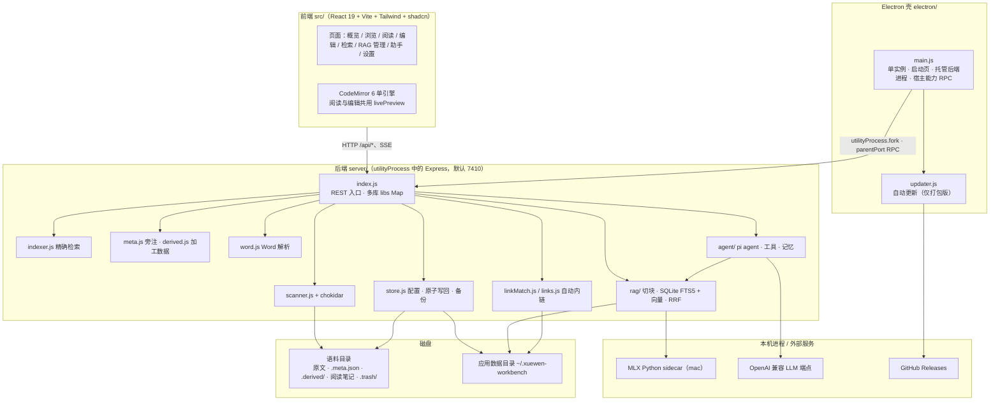

# 学问工作台 · 架构设计文档

版本：v0.4（2026-11-02，第 1–4 批落地后：安全加固 / P1 修复 / 性能 / 包体积与动效）｜读者：主人、后续开发者（含 AI 执行方）｜产品需求见 [PRD.md](./PRD.md)｜各功能实现规格见 [`specs/`](../specs/)

本文只写结构、规则、取舍和坑；实现细节以代码和规格为准，这里只给指针。路径均相对仓库根目录，不含任何语料正文。

**状态**：已实现 = 在主分支且有测试或验收；部分实现 = 主体可用，列出的子项未做；已定未做 = 方案已定未开发；待定 = 未决定，注明取决于什么。

---

## 1. 现状：阅读、编辑、内链、检索、助手都已可用，版本历史与加工数据增量更新未做

学问工作台是给一位教传统文化的老师用的本地桌面应用：以一个或多个语料目录（几百份 md / txt / json / html / Word 文稿）为资料库，集中阅读、检索、编辑，并叠加自动内链、语义检索、AI 助手和二次加工数据。Electron 主进程只管窗口，Express 后端跑在它托管的独立 utilityProcess 里，前端是 React 单页。

| 能力 | 状态 | 主要代码 | 规格 / 文档 |
|---|---|---|---|
| 多资料库工作区（同时打开、切换、移出） | 已实现 | `server/index.js`（`libs` Map）、`server/store.js` | `specs/2026-10-17-logo-scrollbar-multilib.md` |
| 扫描、监听、精确检索 | 已实现 | `server/scanner.js`、`server/indexer.js` | — |
| 文件操作（新建 / 改名 / 移动 / 复制 / 删除，旁注跟随） | 已实现 | `server/index.js`、`src/components/FileTree.tsx` | — |
| 阅读（多标签页、反链、概念 / 主题、划线笔记） | 已实现 | `src/pages/Read.tsx` | — |
| 编辑（CodeMirror 6 实时预览，与阅读同一引擎） | 已实现 | `src/components/editor/` | `specs/2026-10-18-unify-markdown-rendering.md` |
| 自动内链与反向链接 | 已实现 | `server/linkMatch.js`、`server/links.js` | — |
| 元数据旁注与 AI 批量导入 | 已实现 | `server/meta.js`、`schema/` | — |
| 加工数据 `.derived/` | 部分实现：概念 / 主题 / 图谱已只读接入；字义、摘要、「待更新」标记未做 | `server/derived.js` | [derived-data-protocol.md](./derived-data-protocol.md) |
| RAG 智能检索 | 已实现（Windows 先试 DirectML，不可用时 CPU） | `server/rag/` | `specs/2026-10-18-rag.md`、`specs/retrieval-regression.md` |
| 运行日志、卡顿记录与诊断包导出 | 已实现（只导出，不上传） | `server/logger.js`、`server/lagWatch.js`、`server/diagnostics.js` | `specs/2026-11-02-win-freeze-logging.md` |
| 智能助手（pi agent，三层记忆） | 已实现 | `server/agent/`、`src/pages/AgentChat.tsx` | `specs/2026-10-18-agent.md`、`specs/2026-10-19-memory-design.md` |
| 自动更新与 CI 发布 | 已实现 | `electron/updater.js`、`server/update.js`、`.github/workflows/release.yml` | `specs/2026-10-18-auto-update.md` |
| 语料本地版本历史 | 已定未做 | — | 本文 §10 |
| 语音输入 | 待定 | — | [decisions/2026-10-19-voice-input-integration.md](./decisions/2026-10-19-voice-input-integration.md) |

---

## 2. 设计原则

1. **原文是唯一的“真”。** 链接、检索结果、加工数据都只存在于显示层或缓存，不写回原文；保存时除用户改动外字节不变（保留 BOM 与换行）。应用写进语料目录的只有：用户发起的文件操作、`.meta.json` 旁注、阅读笔记目录、`.trash/`（见 §5.1）。
2. **语料默认不出本机。** 不发遥测；对外请求只有 §7 列出的几类。其中 LLM 端点和图像生成会把语料片段发给用户配置的服务，是否用远端服务由主人决定。
3. **派生数据可重建。** `rag.db`、内链缓存、Word 预览缓存删掉即可重建；不可重建的只有原文、`.meta.json` 和 `.derived/`（AI 产出，系统只读）。
4. **稳定 id 做锚点。** 文档 id 为 `doc_` + UUID，生成后永不改，改名、移动不变；概念、图谱等加工数据挂在 id 或路径上，不挂在显示标题上。
5. **跨平台。** macOS arm64 与 Windows x64 都要能跑；平台差异集中在嵌入后端（§6.6）和自动更新（§6.8）两处。

---

## 3. 总体架构



数据主线：扫描读入原文与旁注 → 内存索引（精确检索）、内链词条表（JSON 缓存）、RAG 切块与向量（SQLite）三路派生 → 阅读视图渲染时叠加内链与加工数据 → 编辑保存原子写回原文并同步旁注 `content_hash` → chokidar 触发三路增量更新。

---

## 4. 模块索引

**桌面壳 `electron/`**

| 文件 | 职责 |
|---|---|
| `main.js` | 单实例锁（二次启动还原并显示已有窗口）；启动即建 1440×900 窗口显示启动页；从 7410 起找空闲端口，用 `utilityProcess.fork` 托管后端，后端 `ready` 后切到应用；经 parentPort RPC 向后端提供回收站、系统打开、定位、更新、GPU 信息；后端崩溃时窗口保留，可重启后端或导出诊断包；macOS 用 `hiddenInset` 标题栏 |
| `startup.html` | 启动页：显示启动进度；后端失败或超过 60 秒未就绪时提供「重新启动」「导出诊断信息」 |
| `preload.cjs` | contextBridge 白名单：`selectDirectory`、平台信息、启动页用的 `onBoot` / `exportDiagnostics` / `restartBackend` |
| `updater.js` | 自动更新桥（§6.8） |

**后端 `server/`**

| 文件 | 职责 |
|---|---|
| `index.js` | REST 入口；多库管理（请求带 `?ds=<id>`，缺省当前库）；文件操作与路径安全（`resolveWithin`）；托管构建后的前端 |
| `store.js` | 数据目录定位与迁移、配置、按库状态、原子写、备份目录 |
| `scanner.js` | 扫描资料库，生成文件树；支持格式见 `SUPPORTED_EXTS` |
| `indexer.js` | 内存精确检索（文件名、路径、正文、JSON 键值、Word 提取文本） |
| `linkMatch.js` / `links.js` | 内链匹配引擎 / 词条表、外链、反链与缓存 |
| `meta.js` | `.meta.json` 读写、问题报告、AI 元数据导入 |
| `derived.js` | 读取 `.derived/` 概念、主题、图谱 |
| `word.js` | Word 只读预览：docx 用 mammoth；doc 优先 LibreOffice，缺失时回退 word-extractor 纯文本 |
| `rag/` | 切块 `chunk.js`、存储 `store.js`、嵌入 `embed.js`（MLX sidecar `mlx-embed.py`、ONNX 推理线程 `onnxWorker.js`）、模型下载 `download.js`、参数 `config.js`、编排 `manager.js` |
| `agent/` | `manager.js`（AgentHub：会话、工具、模式、总开关的启停）、`routes.js`（路由与关闭时的 409 拦截）、`memory.js`、`settings.js`（agent 可读写的设置项）、`imagegen.js` |
| `update.js` / `trash.js` / `hostOpen.js` | 宿主能力的可插拔桥：更新、回收站、系统打开与定位；独立运行后端时退化 |
| `host.js` | 托管模式（utilityProcess）下与主进程的 RPC、启动进度与就绪上报；独立运行时为空操作 |
| `logger.js` / `logInit.js` / `lagWatch.js` | 分进程日志（接管 console 写文件、5MB 轮转）与事件循环卡顿看门狗；`logInit.js` 必须是 `index.js` 的第一条 import |
| `diagnostics.js` / `zip.js` | 异常事件记录（`incidents.jsonl`）与诊断 zip 导出 |

**前端 `src/`**：路由 `/`（概览）、`/setup`、`/browse`、`/read/*`、`/edit/*`、`/search`、`/rag`、`/agent`、`/settings`，定义在 `src/App.tsx`（概览以外的页面 `React.lazy` 按需加载，Suspense fallback 用骨架屏）；接口封装在 `src/lib/api.ts`；三套主题 A 宣纸书卷 / B 现代极简 / C 夜读在 `src/styles/themes.css`，可在设置里切换。

---

## 5. 数据与目录

### 5.1 语料目录：原文之外只有四类应用写入

```
<语料目录>/
├── 文章/
│   ├── 论语讲稿.md
│   ├── 论语讲稿.md.meta.json        # 旁注：文档卡，界面默认隐藏
│   └── 某讲义.docx                   # Word 只读
├── 阅读笔记/                         # 划线笔记目录（名称可在设置里改）
│   ├── 某笔记.md
│   └── .某笔记.annotations.json      # 笔记锚点
├── .derived/                         # AI 加工数据，系统只读（已在 .gitignore）
└── .trash/                           # 删除先移入这里
```

- **旁注 `.meta.json`**：命名 `<原文件名含扩展名>.meta.json`，避免同名不同格式冲突。字段以 `schema/meta.schema.json` 为准，导入格式见 `schema/meta-import.schema.json`。`id`、`created_at` 由程序生成且永不改；`content_hash` 由程序维护：导入时计算，保存时同步。应用内改名、移动、删除时旁注跟随；应用外移动造成的孤立旁注或缺旁注文档只报告（`/api/meta/issues`），不静默处理。
- **`.derived/`**：判据是“字段丢了能否从正文重算”——能重算的放这里，不能的进旁注。完整协议见 [derived-data-protocol.md](./derived-data-protocol.md)；旧目录名 `.xuewen/` 首次读取时自动迁移。
- **删除**：先原子移入 `.trash/<时间戳>__<名称>/`（连同旁注）；Electron 下再交给系统回收站，失败则留在 `.trash/`。

### 5.2 应用数据目录：`~/.xuewen-workbench`，开发与打包共用

位置由 `server/store.js` 决定：环境变量 `WORKBENCH_DATA_DIR` 优先，否则为用户目录下的 `.xuewen-workbench`（Windows 为 `%USERPROFILE%`）。该目录不存在时，首次启动会把仓库内的 `server/data/`（早期开发数据位置）整体迁过来；旧的 `sources/<dsId>/` 会迁到 `knowledge/<dsId>/`。

```
~/.xuewen-workbench/
├── config.json             # 多库清单 + 当前库（v2，v1 单库自动迁移）
├── ui-settings.json        # 主题、自动更新开关、笔记目录名、智能助手总开关等
├── llm-settings.json       # LLM 端点（baseUrl / model / apiKey / 思考强度）与助手运行模式
├── links/<dsId>.json       # 内链缓存（JSON，可删）
├── logs/                   # main.log / backend.log / renderer.log（各 5MB×3）、incidents.jsonl、session.json
├── diagnostics/            # 桌面不可写时诊断包的退路
├── memory/                 # 全局记忆
├── agents/default/         # Agent 定义：AGENTS.md、skills/、mcp.json、memory/、models.json
├── models/bge-m3/          # 嵌入模型
├── py/rag-venv/            # MLX Python 环境（mac）
├── generated/              # 生图结果
└── knowledge/<dsId>/       # 按库隔离
    ├── backups/            # 保存前的旧版本
    ├── cache/              # Word 预览等缓存
    ├── rag.db              # 切块 + FTS5 + 向量
    ├── rag-config.json     # 检索参数
    ├── collections.json · metadata.json · recents.json
    ├── memory/             # 库记忆
    └── conversations/<agentId>/   # 该库的助手对话
```

`dsId` 由语料目录绝对路径哈希得出：同一目录移出工作区再加回，数据全部恢复。

---

## 6. 关键机制

### 6.1 多资料库：每库一套常驻实例，请求按 `?ds=` 定位
每个已打开的库有自己的扫描器、索引、内链索引和监听，放在 `server/index.js` 的 `libs` Map 里，`activeId` 指当前库。移出工作区只停监听、卸内存，`knowledge/<dsId>/` 保留。

### 6.2 扫描与监听：约 1 秒防抖后增量重建
chokidar 监听每个库，变化合并防抖后重扫并更新精确索引、内链与 RAG（RAG 按 mtime + size 对账）。扫描跳过隐藏目录（`.git`、`.trash` 等）和旁注；`.derived/` 只在设置打开「显示元数据文件」时进入目录树。网络盘上监听可能失效，顶栏有「重新扫描」手动入口，它会强制重建内链索引。

### 6.3 保存：原子写回 + 写前备份 + 冲突检测
先写临时文件再替换；旧版本备份到 `knowledge/<dsId>/backups/<相对路径>.<时间戳>.bak`。磁盘内容被外部改过时，前端给出「重新加载 / 覆盖 / 继续编辑」。未保存内容有路由拦截和按库隔离的本地草稿。

### 6.4 自动内链：只在渲染层，引擎改输出必须升版本号
词条来自文档标题 / 文件名、旁注 `aliases`、标题锚点、JSON 的 title 字段、`.derived` 概念名与别名；匹配用“核心词 + 包装”模型（编号前缀、系列 / 注释后缀等），最长匹配优先，排除不像名称的文件名，支持屏蔽词表与繁简互通。与显式引用 `集合名|文件名` 并存。

**坑**：缓存签名里含 `server/linkMatch.js` 的 `MATCH_ENGINE_VERSION`。凡改变 `extractLinks` / `termCore` 输出的改动都要把它 +1，否则老库继续复用旧引擎算出的链接。回归测试：`node scripts/test-linkmatch.mjs`。

### 6.5 阅读与编辑：同一个 CodeMirror 引擎渲染，两边观感一致
阅读页渲染只读 CodeMirror 实例，挂与编辑器同一套 `livePreview` 扩展（`src/components/editor/livePreview.ts`），取代了原先 react-markdown 与编辑预览两套实现。硬性要求：编辑保存不改写 Markdown 写法（列表符号、空行、标题风格），避免语料 git 出现无意义 diff。HTML 文档经 DOMPurify 净化后显示；指向库外的链接先确认，再用系统默认应用打开。

### 6.6 RAG：关键词与向量两路召回，RRF 融合
- **切块**：md 按标题层级，txt / docx 按段落，json 按条目，超长节按段落边界二次分组；块上带文档路径、标题路径。
- **存储**：每库一个 `rag.db`（better-sqlite3），FTS5 中文 bigram + 向量 BLOB；可暂停续建（启动时自动续建未完成索引），删除即全量重建。一致性规则：构建中的扫描结束后补跑、向量写入成功才标完成、未对账完显示“待更新”、改参数需清库——清库按批删除（批间让出事件循环，进度随 status 上报），先写「清理中」标记、清完写新指纹，中断后续建先清余量，不会新旧混杂也不会重复清已清的库。
- **检索**：BM25 与余弦各取 top-N，RRF 融合，语义路加权；低于融合阈值不显示，查不到就明说“没有找到”。查询与切块都经繁→简归一化。全部默认值在 `server/rag/config.js`，可在 RAG 管理页按库调整。
- **嵌入**：bge-m3（1024 维）。macOS 走 MLX Python sidecar，Python 环境先尝试 uv 在线置备，否则用安装包内捆绑的离线环境（`scripts/fetch-mlx-env.mjs` 构建期拉取）；Windows 走 onnxruntime-node，在 worker 线程里加载与推理，默认先试 DirectML、不可用时降级 CPU（原因写入 backend.log，`WORKBENCH_RAG_ONNX_EP` 可覆盖）。测试可设 `WORKBENCH_RAG_EMBED=mock`。
- **模型获取**：首次在 RAG 管理页下载。并发探测 huggingface.co 与 hf-mirror.com，按先响应者顺序取；托管模式用 Electron `net.fetch`（Chromium 网络栈，走系统代理）；`.part` 断点续传、30 秒空闲超时、退避重试、连续失败换源；接口立即返回，进度靠轮询。也可手动导入模型目录（流式复制边读边算 sha256，后台任务）。模型不进安装包。
- **任务状态与取消**：模型下载/导入/环境置备共用一套 `progress`（phase：env-extract / env-install / probe / download / verify / copy，含总体字节、百分比、估算标记、速度与剩余时间），`POST /api/rag/model/cancel` 可取消，取消后删半截文件、状态按清单回探。依赖安装两条路径计数口径不同：uv 在线路径一次性联合解析安装，只报「安装依赖（共 N 个包）」（界面为不确定态进度条）；离线捆绑路径逐包安装，报「安装依赖 n/N」。运行时加载（MLX sidecar 拉起、ONNX 建会话）走 `status().runtime`（loading 时给阶段与已用时间，不给百分比）。索引构建状态含 phase（等待文本索引 / 清理旧索引 / 切块 / 嵌入 / 加载模型）、当前文件与块级进度、速度与剩余时间；暂停有 `pausing` 过渡态；构建前置检查失败返回 409 且错误进入状态。mock 后端可用 `WORKBENCH_RAG_MOCK_LOAD_MS` / `WORKBENCH_RAG_MOCK_EMBED_MS` 控制加载与嵌入时长（仅供 e2e）。

### 6.7 智能助手：内嵌 pi agent，工作台能力以工具暴露
- **运行时**：`@earendil-works/pi-coding-agent` SDK 内嵌在后端进程；agent 资源目录为 `agents/default/`，与用户全局 `~/.pi` 隔离。端点是任意 OpenAI 兼容服务（Ollama、LM Studio 或远端），配置存 `llm-settings.json`，自动生成 pi 的 `models.json`。
- **工具**：清单见 `server/agent/manager.js` 的 `TOOL_NAMES`，含检索、读文档、改名移动、读写设置、记忆、生图，以及 pi 内置的 `read` 与 `bash`（`bash` 的工作目录是当前资料库根目录）。
- **运行模式**：auto（全自动）/ confirm（破坏性工具与 `bash` 需用户确认）/ readonly（只给检索阅读类工具）。持久化在 `llm-settings.json`，缺省 confirm；readonly 在会话与工具执行两层生效，权限判断集中在 `tool_call` 钩子，`read` 工具限定资料库与 skills 目录。助手不信任语料库目录下的 `.pi`，MCP 配置只读 `agents/default/mcp.json`；skill 导入校验 zip 条目与名称，删除限定在 skills 目录。
- **记忆与对话**：全局 / agent / 库三层记忆，对话按库、按 agent 存放，单一数据源是 pi 会话文件。设计见 `specs/2026-10-19-memory-design.md`。
- **前端入口**：`/agent` 聊天页，另有阅读页侧栏问答与浮窗问答，会注入当前文档上下文。全部入口受下面的总开关控制。
- **总开关（默认关闭）**：唯一来源是 `ui-settings.agentEnabled`，缺省 false，旧数据没有该字段即视为关闭。
  - 前端：界面设置 Provider（`src/lib/theme.tsx`）启动时读一次，入口一律经 `useAgentEnabled()`（`src/lib/theme-context.ts`）读取，不另存、不各自请求。关闭时顶栏入口、⌘J 与浮窗、快捷键清单那一行、命令面板条目、阅读页 AI 按钮与面板、选区「问 AI」都不渲染，访问 `/agent` 回到概览并提示；设置页「智能助手」切换后即时生效，读取失败按关闭处理。
  - 后端：关闭时 `/api/agent` 只放行只读查看（status、单个会话、生成的图片、记忆、AGENTS.md）与中止生成，其余（chat、确认、导入导出、各类写操作、模型列表）返回 409 `{ error: 'agent-disabled' }`；放行清单在 `server/agent/routes.js`，新增路由默认受拦。
  - 生命周期：`PUT /api/ui-settings` 关闭时经 `AgentHub.setEnabled(false)` 拒绝待确认的工具调用、中止进行中的生成，全部停下才返回，前端随后才隐藏入口。启动期唯一的外部访问（端点上下文窗口探测）推迟到首次开启时；MCP 连接与模型运行时本就随会话懒建。关闭不删对话、记忆与设置。
- **事件处理单一真相源（反馈第 3 批）**：三个对话界面（`AgentChat.tsx` / `QuickAgent.tsx` / `ReadAgentPanel.tsx`）的 SSE 事件全部经 `src/lib/agentReducer.ts` 的 `applyAgentEvent` 归约到同一份轮次状态（正文 / thinking / 工具 / usage / compactions / failure / activity / pendingConfirm），React 侧封装在 `src/hooks/useAgentTurn.ts`；各界面只保留自身特有的副作用分支（`open_doc` 跳转、`settings_changed` 应用设置）。
- **全程活动指示**：activity 取值 connecting / thinking / tool / compacting / confirm / generating，由共用组件 `src/components/agent/AgentActivity.tsx` 渲染（替代各界面的三点动画）；工具卡运行中转圈计时、结束显示耗时、中断有标记（`ToolCard.tsx`）；破坏性工具的确认弹窗共用 `ConfirmToolDialog.tsx`，倒计时与后端 30s 超时一致，超时/关闭弹窗视同拒绝。

### 6.8 自动更新：两端安装过程全程可见
仅打包版启用（开发模式与独立后端下停用），启动 10 秒后首查，之后每 6 小时一次，设置里可关。更新桥留在主进程（`electron/updater.js`），后端经 RPC 调用；状态机快照（`status` / `phase` / `progress`（含速度与剩余时间）/ `canCancel` / `installMode` / `lastInstall`）随 `/api/status` 下发，前端轮询在 checking / downloading / installing 时收紧到 1 秒。

- **Windows**：electron-updater 检查与差量下载；安装 = 非静默 `quitAndInstall(false, true)`，安装器显示进度窗口，装完自动重开（`build/installer.nsh` 让升级跳过「为谁安装」页与完成页，并直接启动新版本）。
- **macOS（未签名）**：electron-updater 只负责检查；下载自取发布源的 DMG（github 走资产通道，不调限流的 api.github.com；也支持 generic provider）。下载完成后预检能否自动替换（AppTranslocation / DMG 卷 / 目录或 bundle 不可写 / 不在 .app 结构中 → 状态为 `ready + installMode:'manual'`，界面给出原因与手动步骤）。可自动替换时点「重启并安装」：`electron/macInstall.js` 在应用内准备（挂载 DMG、校验 bundle id 与版本、ditto 到 `updates/staging`、codesign 验证，全程有进度进状态机），成功后派发 `electron/mac-install.sh` 在退出后替换 bundle、去隔离属性并重新打开；准备失败不退出、回退手动拖拽；替换被拦截时脚本还原旧版并打开 DMG。签名后 mac 可切回 electron-updater。
- **跨重启结果**：`install()` 与下载完成时写 `userData/updates/pending.json`；mac 替换脚本写 `install-result.json`。下次启动早期由 `createUpdaterBridge` 消费并删除：版本已到 toVersion → `lastInstall.result='updated'`；版本未变且 result 为失败 → `'failed'` 带人话原因；版本未变且无 result（用户取消了安装器）→ 保留 pending 不提示。前端 toast 用 sessionStorage 键去重，每会话只提示一次；启动页首条文案（「已更新到 vX，正在启动…」）由主进程在消费删除 pending 之前先读一次。
- **界面**：`UpdateBanner`（available / downloading / ready / error，点击立即 loading、下载可取消）、`UpdateInstallOverlay`（installing 时全窗口遮罩，按 phase 显示阶段文字与进度，不可关闭）、设置页「关于与更新」状态行；文案统一在 `src/lib/updateText.ts`，平台差异只体现在文案。安装会关闭应用，有未保存改动时先弹确认（`src/lib/unsaved.ts` 登记表，编辑页与阅读页原位编辑在脏时注册）。

### 6.9 进程结构与诊断：后端重活不许碰窗口所在的线程
Electron 主进程同时承担 Windows 的窗口消息循环，后端曾在其中运行，扫描、解析 Word、ONNX 推理、下载都会让窗口“未响应”。现在主进程只建窗、托管后端进程、实现宿主 RPC；后端的同步重活最多卡后端自己的 HTTP 服务。三个进程各写一份日志；看门狗记下事件循环阻塞 ≥1 秒的时长与当时的活动（`setActivity` / `withActivity` 登记）；异常退出、后端崩溃、渲染进程崩溃记入 `incidents.jsonl`，下次启动顶部横幅提示；设置页与横幅可一键导出诊断 zip（不含正文、对话、API Key、端点地址）。

**坑**：
- 不得对 ONNX worker 调用 `worker.terminate()`：它正处于 onnxruntime 原生推理时被终止，会因未捕获的 `Napi::Error` 让整个后端进程 SIGABRT。关闭一律走 `close` 消息的优雅流程。
- worker 线程里的 `console` 不经过后端已接管的 console，写不进 backend.log；worker 日志必须发消息给主线程转写。
- utilityProcess 里 `require('electron')` 只有 `net`、`systemPreferences`；需要 `shell`、`app` 的能力都走 RPC。

### 6.10 性能：轮询收敛、编辑器去重渲、大文件分块
- 前端全局状态 Provider value 记忆化、按内容比对；轮询统一走 `src/hooks/usePolling.ts`，窗口隐藏时暂停。
- 编辑器：内链字段带 version，选区变化不再重建装饰与重扫引用；按键不进页面 state，updateListener 合一，格式工具栏自订阅。
- Word 图片外置为 `/api/word/asset` 按需取（不再内嵌 data URI）；TXT 阅读按 200 行一个 `content-visibility` 块；检索结果每批 50 组续载；JSON 节点 memo + 分页。
- 后端建文本索引与算内链每 30ms 让出事件循环（阈值 `WORKBENCH_LAG_THRESHOLD_MS` 可调，供 e2e 验证）。
- 前端除概览外按页面 `React.lazy` 拆分；复制渲染管线（unified/remark）与 `@codemirror/lang-html` 按需加载。
- 动效遵守 `DESIGN.md` §7：侧栏折叠不动画 width（主区宽度一次到位，侧栏内层 transform + opacity 过渡）；面板挂载/卸载统一走 `src/lib/presence.ts`（med 档，离场播完再移除）；阅读页查找条与阅读偏好面板为浮层，不推挤正文；拖拽调宽期间只写 CSS 变量（rAF 节流），松手才提交 state 与持久化。

### 6.11 后台状态与操作反馈：进行中可见，失败必报
- **后台状态**：扫描分片异步（`server/scanner.js` 的 `scanTreeAsync`，每 30ms 让出），`/api/status` 按库下发 `scanning` / `scanned`（已扫文件数）/ `indexing`（`{ phase: null | 'text' | 'links', done, total, startedAt }`）/ `indexError` / `linksReady` / `linksSeq`，当前库在顶层另带一份。前端只有 `src/store/app.tsx` 一条状态轮询：后台忙时 1 秒、空闲 5 秒；`linksSeq` 推进时广播索引就绪事件（`src/lib/indexReady.ts`，组件用 `useWhenIndexReady` 订阅），等待方就绪后再取一次，不各写重试循环。
- **全局指示**：顶栏 `BackgroundIndicator`（正在扫描 / 正在建立索引 / 正在更新链接，持续不到 1 秒的不显示）；精确检索在 text 阶段标注「结果可能不完整」，反链面板未就绪时显示加载而不是空结果。
- **反馈基础件**：失败提示只用 `notify`（`src/lib/notify.ts`，带 `busy` 的条目显示转圈与慢提示）；按钮忙碌态只用 `Button loading`；「慢了才出现的次要文字」只用 `useDelayedFlag`；页面加载用 `PageLoading`（可带 `slowText`，如 Word 首次转换）与 `PageSkeleton`。
- **耗时写操作**（创建、重命名、移动、删除、副本、粘贴、元数据导入、屏蔽词表、元数据文件开关）：后端等重扫与索引完成才返回，前端口径统一在 `src/lib/writeOp.ts`——有按钮或对话框的转圈并锁定，超过 1.5 秒换成「正在更新索引…」；没有对话框的走 `runWriteOp`，一条进行中 toast 收尾为完成或失败。条目操作的执行入口是 `src/lib/entryOps.ts`。
- **切换知识库**：store 的 `switchingLib` 为真时顶栏库名旁转圈、内容区与侧栏显示骨架，新库 config 与目录树到位后才挂载页面。
- **大文档**：超过 256K 字符的 JSON 解析与 TXT 分段推迟到加载态首帧绘制之后（`src/hooks/useAfterPaint.ts`）。

---

## 7. 网络出口与安全：只有 LLM 端点和生图会带出语料相关内容

| 出口 | 触发 | 发出的内容 |
|---|---|---|
| huggingface.co / hf-mirror.com（并发探测择一） | 用户点下载嵌入模型 | 无语料 |
| github.com（DMG 名称取不到时退回 api.github.com） | 打包版检查 / 下载更新，可关闭 | 无语料 |
| 用户配置的 LLM 端点 | 助手对话（助手开启后才访问，含一次上下文窗口探测） | **检索到的语料片段与对话内容** |
| api.uniapi.io | 助手调用 `generate_image`；凭据取 `~/.config/uniapi/config.json` 或 `UNIAPI_API_KEY` | 生图提示词 |
| PyPI（经 uv） | 本机装有 uv 时置备 MLX 环境 | 无语料 |

- 后端默认只绑 `127.0.0.1`（开发模式同样；`WORKBENCH_HOST=0.0.0.0` 才开放局域网）；所有接口校验 Host/Origin 白名单（仅 `127.0.0.1` / `localhost` / `[::1]`），防 DNS rebinding 与跨站请求。
- 托管的前端页面下发带 nonce 的 CSP，主窗口限制导航；Word 预览 HTML 经 DOMPurify 净化；拒绝打开可执行文件；另存为校验符号链接祖先目录。
- 非 UTF-8 文本（GBK、UTF-16）正确解码后只读展示并拒绝写回；检索与内链使用解码后正文。
- 所有按库的文件接口经 `resolveWithin` 校验：拒绝越出库根目录的路径，并跟随符号链接校验真实路径；`/api/reveal` 同样限定库内。
- 语料和加工数据不进代码仓库：`.gitignore` 排除 `server/data/`、`.derived/`、`.env` 等；开发与测试只用 `test-data/` 合成语料。

---

## 8. 构建、发布与测试

**开发**：`npm run dev` 同时起后端（7410）与 Vite（3000）；`npm run electron:dev` 在壳里跑。环境变量：`WORKBENCH_DATA_DIR`、`WORKBENCH_PORT`、`WORKBENCH_HOST`、`WORKBENCH_STATIC_DIR`、`WORKBENCH_RAG_EMBED`、`WORKBENCH_RAG_ONNX_EP`、`WORKBENCH_RAG_MODEL_HOSTS`（逗号分隔，测试用）、`WORKBENCH_LAG_THRESHOLD_MS`（看门狗阈值，测试用）。

**发布**：代码仓库是公开的 GitHub 仓库 `misakaikato/xuewen-workbench`，坐标写在 `package.json` 的 `build.publish`。`npm version patch` 打 tag 并推送后，`.github/workflows/release.yml` 依次执行：
1. `prepare` 预建唯一的 draft release，避免多个发布器各建一个 draft；
2. mac（arm64 dmg + zip）与 win（x64 nsis）并行构建上传；mac job 在 `npm ci` 后先装 uv 与 Python 3.12，运行 `scripts/fetch-mlx-env.mjs` 拉取 MLX 离线环境（`resources-mlx/python.tar.gz` + `wheels/`）并校验产物存在，然后才打包；
3. `finalize` 清理带空格的重复资产，把 draft 发布为 latest。只有发布后客户端才能查到新版本。

本地兜底：`GH_TOKEN=<token> npm run release:mac`（或 `release:win`）。打包配置在 `package.json` 的 `build` 字段：mac 把 `resources-mlx/` 作为 `mlx-env` 放进 Resources，`onnxruntime-node`、`better-sqlite3` 走 asarUnpack，`scripts/afterPack-prune.cjs` 裁剪产物。依赖分类规则：`dependencies` 只保留后端/主进程运行时依赖（含动态 import 的 `@huggingface/transformers`、`onnxruntime-node`、`electron-updater`、`adm-zip`）；仅前端构建用的依赖全部在 `devDependencies`，不进安装包。

**测试**

| 命令 | 覆盖 |
|---|---|
| `npx tsc -b` | 前端类型检查 |
| `npm run lint` | ESLint |
| `node scripts/test-linkmatch.mjs` | 内链匹配引擎回归 |
| `node scripts/test-diagnostics.mjs` | 日志轮转与格式、卡顿看门狗、异常事件、诊断 zip |
| `node scripts/test-download.mjs` | 模型下载：选源、断点续传、空闲超时、失败原因、无句柄残留 |
| `node scripts/test-onnx-worker.mjs` | ONNX worker：夹具模型（需 uv，首次需联网取分词器）比对新旧向量、推理期间主线程延迟、优雅关闭压力 |
| `npm run test:retrieval` | 检索确定性回归：真实 SQLite / 切块 / FTS / RRF，向量为夹具，不评估语义质量 |
| `npm run test:retrieval:e2e` | Electron 内检索与阅读定位端到端（标准见 `specs/retrieval-regression.md`） |
| `npm run test:e2e` | 编辑器端到端 |
| `./node_modules/.bin/electron scripts/e2e-filetree.mjs` | 目录树端到端（先 `npm run build`） |
| `node scripts/test-scan-async.mjs` / `node scripts/test-index-status.mjs` | 异步扫描与旧同步扫描逐项一致、不阻塞事件循环；`/api/status` 索引阶段字段 |
| `./node_modules/.bin/electron scripts/e2e-index-visibility.mjs` / `e2e-files-feedback.mjs` | 后台指示与「结果可能不完整」；文件操作与其余入口的忙碌态、慢提示、失败提示 |
| `node scripts/test-agent-toggle.mjs` | 助手总开关：缺省关闭、409 语义、非法值 400、关闭时不探测模型端点、关闭时中止生成与待确认的工具调用 |
| `./node_modules/.bin/electron scripts/e2e-agent-toggle.mjs` | 助手总开关的全部界面入口：关闭时隐藏、设置页切换即时生效（先 `npm run build`）；既有助手 e2e 在准备阶段先打开开关 |
| `node scripts/acceptance.mjs` | 后端整体验收（配置、扫描、读写、冲突、隔离、路径安全等） |
| `node scripts/retrieval-tests.mjs --url http://127.0.0.1:7410` | 对当前激活库只读跑检索套件，真值由脚本直扫语料自证 |

测试脚本的临时目录一律经 `scripts/tmpdirs.mjs` 的 `makeTmpDir` 创建：正常结束、断言失败、被 `timeout` 终止时都会删除（Electron 脚本经 `will-quit`），后端子进程用 `atExit` 先杀掉再删目录。

---

## 9. 已知缺口

- **模型下载不校验完整性。** 下载后只计算并记录 sha256，没有对照预置值。
- **Windows 嵌入的 GPU 路径未实测。** 默认先试 DirectML，不可用时降级 CPU；DirectML 在老师机器上能否加载、性能如何都没测过。CUDA EP（RTX 5070 / Blackwell）未做。
- **进程拆分、下载重写、ONNX worker 只在 macOS 验证过**（含打包产物与夹具模型），Windows 真机未验证。2026-11-02 的 Windows 卡死事故（下载模型时界面卡住、`fetch failed`、结束进程后重开不显示）根因尚未用该机器的日志确认。
- **安装包未签名。** 首次打开需接受 Gatekeeper / SmartScreen 提示；mac 自动更新因此只能半自动。
- **本机打 DMG 可能被系统服务卡住。** dmgbuild 最后一步是非强制卸载；若 CoreSimulatorService 卡在 “Simulators are still shutting down”，它会经 DiskArbitration 否决一切非强制卸载，任何工具都造不出 DMG，只能清理相关进程或重启。诊断与后备：`node scripts/make-dmg.mjs`。

---

## 10. 未做与待定

| 事项 | 状态 | 说明 / 取决于 |
|---|---|---|
| 语料本地版本历史 | 已定未做 | 用 isomorphic-git（Windows 不需装 git），保存时自动提交，永不配置远程，界面可查看与恢复；与现有 `backups/` 的关系实现时再定 |
| `.derived` 「待更新」与增量重加工 | 已定未做 | 旁注 `content_hash` 与加工记录 `source_hash` 不符时标记待更新，只重加工变动文档；`source_hash` 目前只解析不比对 |
| 字义 `ziyi.jsonl`、摘要 `summaries.jsonl` 接入 | 协议已定，未接入 | 见 derived-data-protocol.md |
| 语音输入 | 待定 | 倾向以独立进程复用 Handy 的识别能力，先验证短句口述；待产品取舍 |
| 辅助写书 | 暂缓 | 主人决定是否启动；若启动，复用文档 id 做可溯源引文 |
| 加工任务面板（覆盖率、待更新数） | 已定未做 | 依赖「待更新」机制 |
