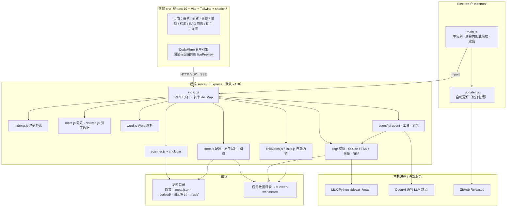

# 学问工作台 · 架构设计文档

版本：v0.3（2026-11-02，对应代码 v0.1.6 / `a3a4977`）｜读者：主人、后续开发者（含 AI 执行方）｜产品需求见 [PRD.md](./PRD.md)｜各功能实现规格见 [`specs/`](../specs/)

本文只写结构、规则、取舍和坑；实现细节以代码和规格为准，这里只给指针。路径均相对仓库根目录，不含任何语料正文。

**状态**：已实现 = 在主分支且有测试或验收；部分实现 = 主体可用，列出的子项未做；已定未做 = 方案已定未开发；待定 = 未决定，注明取决于什么。

---

## 1. 现状：阅读、编辑、内链、检索、助手都已可用，版本历史与加工数据增量更新未做

学问工作台是给一位教传统文化的老师用的本地桌面应用：以一个或多个语料目录（几百份 md / txt / json / html / Word 文稿）为资料库，集中阅读、检索、编辑，并叠加自动内链、语义检索、AI 助手和二次加工数据。Electron 壳在进程内跑 Express 后端，前端是 React 单页。

| 能力 | 状态 | 主要代码 | 规格 / 文档 |
|---|---|---|---|
| 多资料库工作区（同时打开、切换、移出） | 已实现 | `server/index.js`（`libs` Map）、`server/store.js` | `specs/2026-10-17-logo-scrollbar-multilib.md` |
| 扫描、监听、精确检索 | 已实现 | `server/scanner.js`、`server/indexer.js` | — |
| 文件操作（新建 / 改名 / 移动 / 复制 / 删除，旁注跟随） | 已实现 | `server/index.js`、`src/components/FileTree.tsx` | — |
| 阅读（多标签页、反链、概念 / 主题、划线笔记） | 已实现 | `src/pages/Read.tsx` | — |
| 编辑（CodeMirror 6 实时预览，与阅读同一引擎） | 已实现 | `src/components/editor/` | `specs/2026-10-18-unify-markdown-rendering.md` |
| 自动内链与反向链接 | 已实现 | `server/linkMatch.js`、`server/links.js` | — |
| 元数据旁注与 AI 批量导入 | 已实现 | `server/meta.js`、`schema/` | — |
| 加工数据 `.derived/` | 部分实现：概念 / 主题 / 图谱已只读接入；字义、摘要、「待更新」标记未做 | `server/derived.js` | [derived-data-protocol.md](./derived-data-protocol.md) |
| RAG 智能检索 | 已实现（Windows 仅 CPU） | `server/rag/` | `specs/2026-10-18-rag.md`、`specs/retrieval-regression.md` |
| 智能助手（pi agent，三层记忆） | 已实现 | `server/agent/`、`src/pages/AgentChat.tsx` | `specs/2026-10-18-agent.md`、`specs/2026-10-19-memory-design.md` |
| 自动更新与 CI 发布 | 已实现 | `electron/updater.js`、`server/update.js`、`.github/workflows/release.yml` | `specs/2026-10-18-auto-update.md` |
| 语料本地版本历史 | 已定未做 | — | 本文 §10 |
| 语音输入 | 待定 | — | [decisions/2026-10-19-voice-input-integration.md](./decisions/2026-10-19-voice-input-integration.md) |

---

## 2. 设计原则

1. **原文是唯一的“真”。** 链接、检索结果、加工数据都只存在于显示层或缓存，不写回原文；保存时除用户改动外字节不变（保留 BOM 与换行）。应用写进语料目录的只有：用户发起的文件操作、`.meta.json` 旁注、阅读笔记目录、`.trash/`（见 §5.1）。
2. **语料默认不出本机。** 不发遥测；对外请求只有 §7 列出的几类。其中 LLM 端点和图像生成会把语料片段发给用户配置的服务，是否用远端服务由主人决定。
3. **派生数据可重建。** `rag.db`、内链缓存、Word 预览缓存删掉即可重建；不可重建的只有原文、`.meta.json` 和 `.derived/`（AI 产出，系统只读）。
4. **稳定 id 做锚点。** 文档 id 为 `doc_` + UUID，生成后永不改，改名、移动不变；概念、图谱等加工数据挂在 id 或路径上，不挂在显示标题上。
5. **跨平台。** macOS arm64 与 Windows x64 都要能跑；平台差异集中在嵌入后端（§6.6）和自动更新（§6.8）两处。

---

## 3. 总体架构



数据主线：扫描读入原文与旁注 → 内存索引（精确检索）、内链词条表（JSON 缓存）、RAG 切块与向量（SQLite）三路派生 → 阅读视图渲染时叠加内链与加工数据 → 编辑保存原子写回原文并同步旁注 `content_hash` → chokidar 触发三路增量更新。

---

## 4. 模块索引

**桌面壳 `electron/`**

| 文件 | 职责 |
|---|---|
| `main.js` | 单实例锁；从 7410 起找空闲端口，进程内 import 后端；轮询 `/api/config` 就绪（最长 180 秒）后建 1440×900 窗口；macOS 用 `hiddenInset` 标题栏；注入系统回收站、系统默认应用打开、更新桥 |
| `preload.cjs` | contextBridge 白名单，只暴露 `selectDirectory` 与平台信息 |
| `updater.js` | 自动更新桥（§6.8） |

**后端 `server/`**

| 文件 | 职责 |
|---|---|
| `index.js` | REST 入口；多库管理（请求带 `?ds=<id>`，缺省当前库）；文件操作与路径安全（`resolveWithin`）；托管构建后的前端 |
| `store.js` | 数据目录定位与迁移、配置、按库状态、原子写、备份目录 |
| `scanner.js` | 扫描资料库，生成文件树；支持格式见 `SUPPORTED_EXTS` |
| `indexer.js` | 内存精确检索（文件名、路径、正文、JSON 键值、Word 提取文本） |
| `linkMatch.js` / `links.js` | 内链匹配引擎 / 词条表、外链、反链与缓存 |
| `meta.js` | `.meta.json` 读写、问题报告、AI 元数据导入 |
| `derived.js` | 读取 `.derived/` 概念、主题、图谱 |
| `word.js` | Word 只读预览：docx 用 mammoth；doc 优先 LibreOffice，缺失时回退 word-extractor 纯文本 |
| `rag/` | 切块 `chunk.js`、存储 `store.js`、嵌入 `embed.js`（含 MLX sidecar `mlx-embed.py`）、参数 `config.js`、编排 `manager.js` |
| `agent/` | `manager.js`（AgentHub：会话、工具、模式）、`memory.js`、`settings.js`（agent 可读写的设置项）、`imagegen.js` |
| `update.js` / `trash.js` / `hostOpen.js` | 宿主能力的可插拔桥：更新、回收站、系统打开；独立运行后端时退化 |

**前端 `src/`**：路由 `/`（概览）、`/setup`、`/browse`、`/read/*`、`/edit/*`、`/search`、`/rag`、`/agent`、`/settings`，定义在 `src/App.tsx`；接口封装在 `src/lib/api.ts`；三套主题 A 宣纸书卷 / B 现代极简 / C 夜读在 `src/styles/themes.css`，可在设置里切换。

---

## 5. 数据与目录

### 5.1 语料目录：原文之外只有四类应用写入

```
<语料目录>/
├── 文章/
│   ├── 论语讲稿.md
│   ├── 论语讲稿.md.meta.json        # 旁注：文档卡，界面默认隐藏
│   └── 某讲义.docx                   # Word 只读
├── 阅读笔记/                         # 划线笔记目录（名称可在设置里改）
│   ├── 某笔记.md
│   └── .某笔记.annotations.json      # 笔记锚点
├── .derived/                         # AI 加工数据，系统只读（已在 .gitignore）
└── .trash/                           # 删除先移入这里
```

- **旁注 `.meta.json`**：命名 `<原文件名含扩展名>.meta.json`，避免同名不同格式冲突。字段以 `schema/meta.schema.json` 为准，导入格式见 `schema/meta-import.schema.json`。`id`、`created_at` 由程序生成且永不改；`content_hash` 由程序维护：导入时计算，保存时同步。应用内改名、移动、删除时旁注跟随；应用外移动造成的孤立旁注或缺旁注文档只报告（`/api/meta/issues`），不静默处理。
- **`.derived/`**：判据是“字段丢了能否从正文重算”——能重算的放这里，不能的进旁注。完整协议见 [derived-data-protocol.md](./derived-data-protocol.md)；旧目录名 `.xuewen/` 首次读取时自动迁移。
- **删除**：先原子移入 `.trash/<时间戳>__<名称>/`（连同旁注）；Electron 下再交给系统回收站，失败则留在 `.trash/`。

### 5.2 应用数据目录：`~/.xuewen-workbench`，开发与打包共用

位置由 `server/store.js` 决定：环境变量 `WORKBENCH_DATA_DIR` 优先，否则为用户目录下的 `.xuewen-workbench`（Windows 为 `%USERPROFILE%`）。该目录不存在时，首次启动会把仓库内的 `server/data/`（早期开发数据位置）整体迁过来；旧的 `sources/<dsId>/` 会迁到 `knowledge/<dsId>/`。

```
~/.xuewen-workbench/
├── config.json             # 多库清单 + 当前库（v2，v1 单库自动迁移）
├── ui-settings.json        # 主题、自动更新开关、笔记目录名等
├── llm-settings.json       # LLM 端点（baseUrl / model / apiKey / 思考强度）
├── links/<dsId>.json       # 内链缓存（JSON，可删）
├── memory/                 # 全局记忆
├── agents/default/         # Agent 定义：AGENTS.md、skills/、mcp.json、memory/、models.json
├── models/bge-m3/          # 嵌入模型
├── py/rag-venv/            # MLX Python 环境（mac）
├── generated/              # 生图结果
└── knowledge/<dsId>/       # 按库隔离
    ├── backups/            # 保存前的旧版本
    ├── cache/              # Word 预览等缓存
    ├── rag.db              # 切块 + FTS5 + 向量
    ├── rag-config.json     # 检索参数
    ├── collections.json · metadata.json · recents.json
    ├── memory/             # 库记忆
    └── conversations/<agentId>/   # 该库的助手对话
```

`dsId` 由语料目录绝对路径哈希得出：同一目录移出工作区再加回，数据全部恢复。

---

## 6. 关键机制

### 6.1 多资料库：每库一套常驻实例，请求按 `?ds=` 定位
每个已打开的库有自己的扫描器、索引、内链索引和监听，放在 `server/index.js` 的 `libs` Map 里，`activeId` 指当前库。移出工作区只停监听、卸内存，`knowledge/<dsId>/` 保留。

### 6.2 扫描与监听：约 1 秒防抖后增量重建
chokidar 监听每个库，变化合并防抖后重扫并更新精确索引、内链与 RAG（RAG 按 mtime + size 对账）。扫描跳过隐藏目录（`.git`、`.trash` 等）和旁注；`.derived/` 只在设置打开「显示元数据文件」时进入目录树。网络盘上监听可能失效，顶栏有「重新扫描」手动入口，它会强制重建内链索引。

### 6.3 保存：原子写回 + 写前备份 + 冲突检测
先写临时文件再替换；旧版本备份到 `knowledge/<dsId>/backups/<相对路径>.<时间戳>.bak`。磁盘内容被外部改过时，前端给出「重新加载 / 覆盖 / 继续编辑」。未保存内容有路由拦截和按库隔离的本地草稿。

### 6.4 自动内链：只在渲染层，引擎改输出必须升版本号
词条来自文档标题 / 文件名、旁注 `aliases`、标题锚点、JSON 的 title 字段、`.derived` 概念名与别名；匹配用“核心词 + 包装”模型（编号前缀、系列 / 注释后缀等），最长匹配优先，排除不像名称的文件名，支持屏蔽词表与繁简互通。与显式引用 `集合名|文件名` 并存。

**坑**：缓存签名里含 `server/linkMatch.js` 的 `MATCH_ENGINE_VERSION`。凡改变 `extractLinks` / `termCore` 输出的改动都要把它 +1，否则老库继续复用旧引擎算出的链接。回归测试：`node scripts/test-linkmatch.mjs`。

### 6.5 阅读与编辑：同一个 CodeMirror 引擎渲染，两边观感一致
阅读页渲染只读 CodeMirror 实例，挂与编辑器同一套 `livePreview` 扩展（`src/components/editor/livePreview.ts`），取代了原先 react-markdown 与编辑预览两套实现。硬性要求：编辑保存不改写 Markdown 写法（列表符号、空行、标题风格），避免语料 git 出现无意义 diff。HTML 文档经 DOMPurify 净化后显示；指向库外的链接先确认，再用系统默认应用打开。

### 6.6 RAG：关键词与向量两路召回，RRF 融合
- **切块**：md 按标题层级，txt / docx 按段落，json 按条目，超长节按段落边界二次分组；块上带文档路径、标题路径。
- **存储**：每库一个 `rag.db`（better-sqlite3），FTS5 中文 bigram + 向量 BLOB；可暂停续建，删除即全量重建。
- **检索**：BM25 与余弦各取 top-N，RRF 融合，语义路加权；低于融合阈值不显示，查不到就明说“没有找到”。查询与切块都经繁→简归一化。全部默认值在 `server/rag/config.js`，可在 RAG 管理页按库调整。
- **嵌入**：bge-m3（1024 维）。macOS 走 MLX Python sidecar，Python 环境先尝试 uv 在线置备，否则用安装包内捆绑的离线环境（`scripts/fetch-mlx-env.mjs` 构建期拉取）；Windows 走 onnxruntime-node，目前只用 CPU。测试可设 `WORKBENCH_RAG_EMBED=mock`。
- **模型获取**：首次在 RAG 管理页下载，huggingface.co 失败回退 hf-mirror.com；也可手动导入模型目录。模型不进安装包。

### 6.7 智能助手：内嵌 pi agent，工作台能力以工具暴露
- **运行时**：`@earendil-works/pi-coding-agent` SDK 内嵌在后端进程；agent 资源目录为 `agents/default/`，与用户全局 `~/.pi` 隔离。端点是任意 OpenAI 兼容服务（Ollama、LM Studio 或远端），配置存 `llm-settings.json`，自动生成 pi 的 `models.json`。
- **工具**：清单见 `server/agent/manager.js` 的 `TOOL_NAMES`，含检索、读文档、改名移动、读写设置、记忆、生图，以及 pi 内置的 `read` 与 `bash`（`bash` 的工作目录是当前资料库根目录）。
- **运行模式**：auto（全自动）/ confirm（破坏性工具与 `bash` 需用户确认）/ readonly（只给检索阅读类工具）。
- **记忆与对话**：全局 / agent / 库三层记忆，对话按库、按 agent 存放，单一数据源是 pi 会话文件。设计见 `specs/2026-10-19-memory-design.md`。
- **前端入口**：`/agent` 聊天页，另有阅读页侧栏问答与浮窗问答，会注入当前文档上下文。

### 6.8 自动更新：Windows 全自动，macOS 半自动
仅打包版启用（开发模式与独立后端下停用），启动 10 秒后首查，之后每 6 小时一次，设置里可关。Windows 用 electron-updater：blockmap 差量下载、安装并重启。macOS 未签名，electron-updater 只负责检查；下载从 `github.com/.../releases/download/` 直接取 DMG（不调限流的 api.github.com），然后打开安装包并退出，由用户拖入 Applications。签名后 mac 可切回 electron-updater。

---

## 7. 网络出口与安全：只有 LLM 端点和生图会带出语料相关内容

| 出口 | 触发 | 发出的内容 |
|---|---|---|
| huggingface.co → hf-mirror.com | 用户点下载嵌入模型 | 无语料 |
| github.com（DMG 名称取不到时退回 api.github.com） | 打包版检查 / 下载更新，可关闭 | 无语料 |
| 用户配置的 LLM 端点 | 助手对话 | **检索到的语料片段与对话内容** |
| api.uniapi.io | 助手调用 `generate_image`；凭据取 `~/.config/uniapi/config.json` 或 `UNIAPI_API_KEY` | 生图提示词 |
| PyPI（经 uv） | 本机装有 uv 时置备 MLX 环境 | 无语料 |

- Electron 下后端只绑 `127.0.0.1`，不对局域网开放。
- 所有按库的文件接口经 `resolveWithin` 校验：拒绝越出库根目录的路径，并跟随符号链接校验真实路径；`/api/reveal` 同样限定库内。
- 语料和加工数据不进代码仓库：`.gitignore` 排除 `server/data/`、`.derived/`、`.env` 等；开发与测试只用 `test-data/` 合成语料。

---

## 8. 构建、发布与测试

**开发**：`npm run dev` 同时起后端（7410）与 Vite（3000）；`npm run electron:dev` 在壳里跑。环境变量：`WORKBENCH_DATA_DIR`、`WORKBENCH_PORT`、`WORKBENCH_HOST`、`WORKBENCH_STATIC_DIR`、`WORKBENCH_RAG_EMBED`。

**发布**：代码仓库是公开的 GitHub 仓库 `misakaikato/xuewen-workbench`，坐标写在 `package.json` 的 `build.publish`。`npm version patch` 打 tag 并推送后，`.github/workflows/release.yml` 依次执行：
1. `prepare` 预建唯一的 draft release，避免多个发布器各建一个 draft；
2. mac（arm64 dmg + zip）与 win（x64 nsis）并行构建上传；
3. `finalize` 清理带空格的重复资产，把 draft 发布为 latest。只有发布后客户端才能查到新版本。

本地兜底：`GH_TOKEN=<token> npm run release:mac`（或 `release:win`）。打包配置在 `package.json` 的 `build` 字段：mac 把 `resources-mlx/` 作为 `mlx-env` 放进 Resources，`onnxruntime-node`、`better-sqlite3` 走 asarUnpack，`scripts/afterPack-prune.cjs` 裁剪产物。

**测试**

| 命令 | 覆盖 |
|---|---|
| `npx tsc -b` | 前端类型检查 |
| `npm run lint` | ESLint |
| `node scripts/test-linkmatch.mjs` | 内链匹配引擎回归 |
| `npm run test:retrieval` | 检索确定性回归：真实 SQLite / 切块 / FTS / RRF，向量为夹具，不评估语义质量 |
| `npm run test:retrieval:e2e` | Electron 内检索与阅读定位端到端（标准见 `specs/retrieval-regression.md`） |
| `npm run test:e2e` | 编辑器端到端 |
| `./node_modules/.bin/electron scripts/e2e-filetree.mjs` | 目录树端到端（先 `npm run build`） |
| `node scripts/acceptance.mjs` | 后端整体验收（配置、扫描、读写、冲突、隔离、路径安全等） |
| `node scripts/retrieval-tests.mjs --url http://127.0.0.1:7410` | 对当前激活库只读跑检索套件，真值由脚本直扫语料自证 |

---

## 9. 已知缺口：前三条影响已发布版本的用户

- **CI 打出的 mac 包很可能缺离线 MLX 环境。** 【推断，未解包核实】`release.yml` 没有运行 `scripts/fetch-mlx-env.mjs`，而 `resources-mlx/` 下入库的只有 `requirements.txt`（`python.tar.gz` 与 `wheels/` 被 gitignore）。v0.1.6 的 CI mac 包 232 MB，本地带捆绑的 0.1.4 包 322 MB，差值与捆绑体积（约 91 MB）吻合。后果：没装 uv 的 Mac 下载模型时会报「MLX 环境不可用」。
- **v0.1.1–v0.1.3 的数据升级后不会迁移。** 这三个发布版把数据放在系统 userData 下的 `data/`（macOS 为 `~/Library/Application Support/Xuewen Workbench/data`）。v0.1.4 起 `electron/main.js` 不再传 `WORKBENCH_DATA_DIR`，`store.js` 里按该变量迁移 userData 的分支因此走不到。从这几个版本自动更新上来的用户，资料库清单、RAG 索引、模型和对话都要重新来过；旧数据仍留在原处。
- **助手运行模式不持久化，启动恒为 auto。** `mode` 只存在 `AgentHub` 内存里；每次启动后 `bash`、改名、移动等工具都不经确认直接执行，`bash` 可在资料库根目录跑任意命令。
- **开发模式后端监听所有地址。** `npm run dev` / `dev:server` 不设 `WORKBENCH_HOST` 时 `app.listen` 不限地址，局域网内可访问全部接口（含助手）。
- **模型下载不校验完整性。** 下载后只计算并记录 sha256，没有对照预置值。
- **Windows 嵌入只跑 CPU。** CUDA EP（RTX 5070 / Blackwell）是规格里的实测点，未做。
- **安装包未签名。** 首次打开需接受 Gatekeeper / SmartScreen 提示；mac 自动更新因此只能半自动。
- **本机打 DMG 可能被系统服务卡住。** dmgbuild 最后一步是非强制卸载；若 CoreSimulatorService 卡在 “Simulators are still shutting down”，它会经 DiskArbitration 否决一切非强制卸载，任何工具都造不出 DMG，只能清理相关进程或重启。诊断与后备：`node scripts/make-dmg.mjs`。
- **仅前端用的依赖仍在 `dependencies`。** 前端已被 Vite 打成静态文件，这些依赖本可移到 `devDependencies` 给安装包瘦身。

---

## 10. 未做与待定

| 事项 | 状态 | 说明 / 取决于 |
|---|---|---|
| 语料本地版本历史 | 已定未做 | 用 isomorphic-git（Windows 不需装 git），保存时自动提交，永不配置远程，界面可查看与恢复；与现有 `backups/` 的关系实现时再定 |
| `.derived` 「待更新」与增量重加工 | 已定未做 | 旁注 `content_hash` 与加工记录 `source_hash` 不符时标记待更新，只重加工变动文档；`source_hash` 目前只解析不比对 |
| 字义 `ziyi.jsonl`、摘要 `summaries.jsonl` 接入 | 协议已定，未接入 | 见 derived-data-protocol.md |
| 语音输入 | 待定 | 倾向以独立进程复用 Handy 的识别能力，先验证短句口述；待产品取舍 |
| 辅助写书 | 暂缓 | 主人决定是否启动；若启动，复用文档 id 做可溯源引文 |
| 加工任务面板（覆盖率、待更新数） | 已定未做 | 依赖「待更新」机制 |
